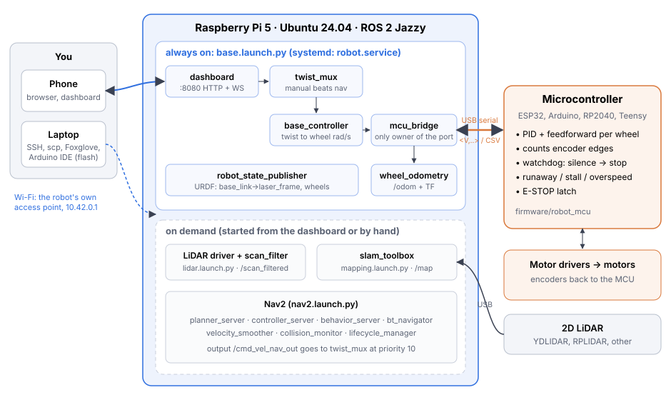
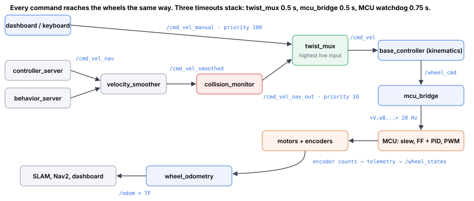
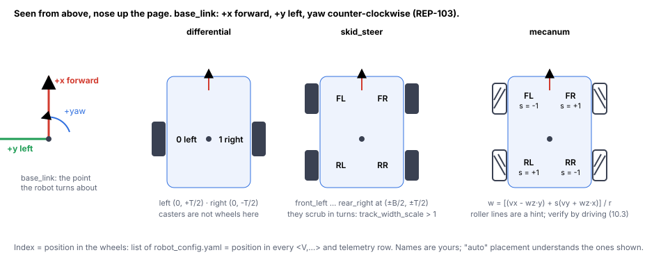
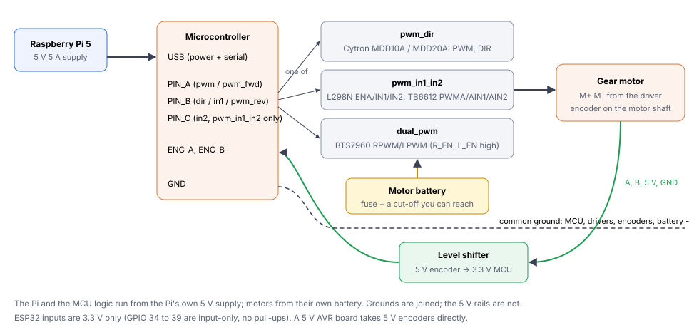
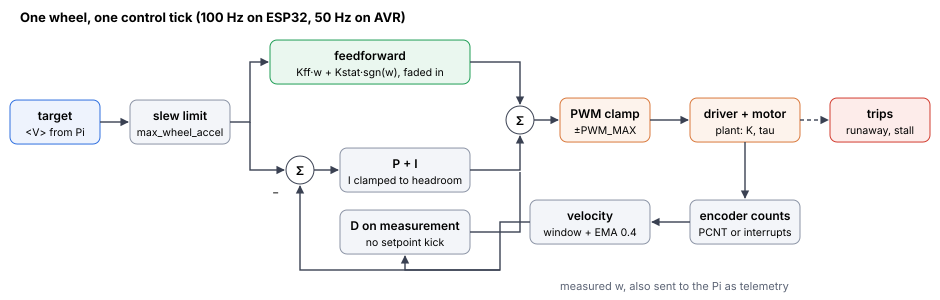
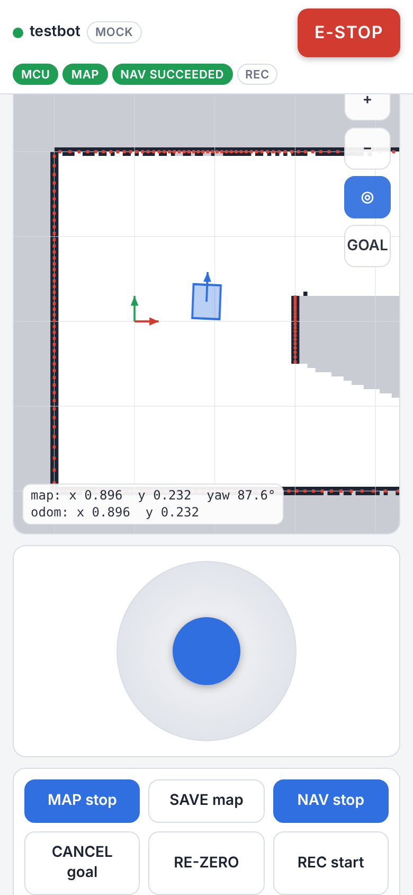
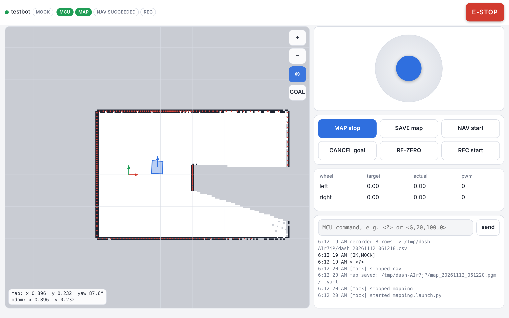

# 1. Before you start {#before}

You'll need a Raspberry Pi 5, a microSD card, your robot (motors, encoders, a microcontroller, a motor driver, a 2D LiDAR) and a laptop on the same desk. Put the robot on blocks so the wheels hang free. Almost every test in chapters 7 and 9 assumes the wheels are in the air, and the first time a sign is wrong you'll be glad they were.

## 1.1 What you have

The kit is a folder, `robot_kit/`. Everything specific to your robot lives in one file inside it, `robot_config.yaml`. A script, `generate.py`, reads that file and writes every other robot-specific file: the URDF, the ROS parameter files, the Nav2 and SLAM configs, the udev rule and the microcontroller's header. You never edit those by hand. Change the YAML, run the script, rebuild.

| Folder | What's in it |
|---|---|
| `robot_config.yaml` | your robot, the one file you edit (chapter 3) |
| `generate.py` | turns it into everything else |
| `examples/` | a 4WD skid steer on an Arduino Mega, and NarrowAisleBot itself, for reference |
| `setup/` | numbered install scripts for a fresh Pi, a USB device lister, a health check |
| `firmware/robot_mcu/` | the microcontroller sketch, for ESP32, AVR, RP2040 or Teensy |
| `ros2/robot_base/` | the ROS 2 package: bridge, kinematics, odometry, scan filter, dashboard, launch files |
| `tools/` | the encoder logger (PID calibration), the CSV analyser, the firmware simulator |
| `tests/` | the checks that were run on all of the above (Appendix B) |

Copy the folder to the Pi's home directory so it sits at `~/robot_kit`. If you got it as a zip, on your laptop:

```bash
scp robot_kit.zip <user>@<pi-address>:~
```

and on the Pi:

```bash
cd ~ && unzip robot_kit.zip && cd robot_kit && ls
```

## 1.2 What has been tested, and what hasn't

I'd rather you know this now than discover it on the bench.

| Part | Status |
|---|---|
| Kinematics (differential, skid steer, mecanum, omni) | Tested in software. Reproduces NarrowAisleBot's asymmetric mecanum equations exactly. |
| `generate.py` | Tested on three different robots, including bad configs it must reject. |
| Firmware logic (PID, feedforward, parser, telemetry, watchdog, E-STOP, trips) | Compiled from the real sketch with g++ and run against simulated motors with real quadrature edges, 60 checks on three robots. **Not yet flashed on hardware.** The ESP32-only lines (PCNT, ledc, FreeRTOS tasks) are NarrowAisleBot's, which do run on hardware. |
| Encoder logger | Run end to end against that simulator over a pseudo-terminal. Recovers the simulated motor's constants (Kff within 0.3 %, Kstat within 0.1 PWM). |
| Dashboard | Run in headless Chromium in mock mode: 21 checks, no console errors. |
| ROS 2 nodes and launch files | Written against Jazzy APIs, compiled and lint-clean, structure copied from what runs on NarrowAisleBot. **Not run under ROS here**, because the machine that built this kit had no ROS. First bring-up on your Pi is the real test. |
| Nav2 configuration | A starting point. Ours doesn't reach goals reliably yet (chapter 14). |

So: the parts you can't easily debug (the control maths, the logger, the protocol) were checked hard. The ROS glue is simple and close to code we run every day, but it hasn't met a real ROS install in this exact form. Chapter 10 walks through bringing it up one node at a time for that reason.

## 1.3 Habits that saved us time

These come from a year of NarrowAisleBot sessions. Each one is here because ignoring it once cost a day.

1. One step at a time, and look at the actual output before the next step. Never assume a command worked because it printed nothing.
2. Ask the live system, not a file. `ros2 param get /node name` tells you what is running; a YAML file tells you what someone meant to run. We once drove for three days on SLAM defaults because a tuned file never reached the Pi. `setup/check_robot.sh` does this for you.
3. When you copy a file to the Pi, hash it on both ends (`sha256sum file`), per file. Batches hide the one that didn't arrive.
4. Write your prediction down before a test or a drive. "It should reach the goal, 60 % sure" takes ten seconds and turns a surprise into information.
5. Keep a dated log of what you changed and what you measured. Your future self is the main reader.
6. The Pi doesn't need internet for routine work. Get it online for installs, then go back to the robot's own Wi-Fi (chapter 6).

# 2. How the system fits together {#shape}

## 2.1 Two computers, one cable

The microcontroller does the fast, hard real-time work: it counts encoder edges, runs a velocity loop on every wheel at 50 to 100 Hz, and stops the motors by itself if the Pi goes quiet. The Pi does everything that needs a map, a plan or a person: kinematics, odometry, SLAM, navigation, the phone dashboard. Between them is one USB serial cable and a small text protocol.

{width=100%}

That split is deliberate. If the Pi crashes, reboots or just gets slow, the wheels don't care for 750 ms and then they stop. If you need to change how the robot plans a path, you never touch the firmware.

## 2.2 How a command reaches the wheels

Every way of driving, whether it's your thumb on the phone or Nav2, ends at the same node, `base_controller`, through `twist_mux`. Manual input has priority 100 and navigation has 10, so the moment you touch the joystick you own the robot, and you keep it until 0.5 s after you let go.

{width=100%}

Topic names, so you can find them with `ros2 topic list`:

| Topic | Type | From | To |
|---|---|---|---|
| `/cmd_vel_manual` | Twist | dashboard, keyboard teleop | twist_mux |
| `/cmd_vel_nav_out` | Twist | collision_monitor (Nav2) | twist_mux |
| `/cmd_vel` | Twist | twist_mux | base_controller |
| `/wheel_cmd` | Float64MultiArray | base_controller | mcu_bridge |
| `/wheel_states` | JointState (position rad, velocity rad/s, effort = PWM) | mcu_bridge | wheel_odometry |
| `/mcu/telemetry` | Float64MultiArray `[mcu_ms, values...]` | mcu_bridge | dashboard, telemetry_logger |
| `/mcu/status` | String (every `[...]` line from the firmware) | mcu_bridge | dashboard |
| `/mcu/command` | String, raw protocol | dashboard | mcu_bridge |
| `/odom` + TF `odom → base_link` | Odometry | wheel_odometry | SLAM, Nav2, dashboard |
| `/odom/reset` | Empty | dashboard | wheel_odometry |
| `/scan` → `/scan_filtered` | LaserScan | LiDAR driver → scan_filter | SLAM, costmaps, dashboard |
| `/map` + TF `map → odom` | OccupancyGrid | slam_toolbox | Nav2, dashboard |
| `/goal_pose` | PoseStamped | dashboard | bt_navigator |

## 2.3 Axes: use REP-103 and nothing else {#axes}

The ROS convention (REP-103) is +x forward, +y left, +z up, and yaw counter-clockwise when you look down on the robot. Every Nav2 plugin, RViz, Foxglove, slam_toolbox and every recovery behaviour assumes it.

On NarrowAisleBot we didn't follow it. Our `base_link` has +x to the robot's right and +y forward, a choice made early so the LiDAR calibration we already had would line up. It looked like a one-line decision. It has since needed an adapter node on the velocity path, a second one for goals, swapped values throughout the Nav2 file, two MPPI critics switched off, and a recovery behaviour (BackUp) that strafes sideways instead of reversing. The first autonomous goal went 0.956 m at 88° to the direction asked for. Our own config file calls it "the stack's deepest open issue".

Don't repeat it. This kit is REP-103 from the URDF down, and the generator writes stock-shaped Nav2 values. If your LiDAR is mounted backwards or reports angles the wrong way round, that's fixed where it belongs: a yaw in the URDF mount, or the `mirror` flag in the scan filter (chapter 12), never by redefining the robot's axes.

{width=100%}

## 2.4 Frames

| Parent → child | Published by | Notes |
|---|---|---|
| `map → odom` | slam_toolbox | only while mapping. AMCL would publish it in saved-map mode; never run both. |
| `odom → base_link` | wheel_odometry | the robot's dead-reckoned pose; the only pose source until an IMU and EKF arrive |
| `base_link → laser_frame` | robot_state_publisher (URDF) | the measured LiDAR mount. No other node may publish it. |
| `base_link → chassis, wheel_*` | robot_state_publisher | fixed joints, so they always exist in TF |

`base_link` in this kit sits on the floor directly under the point the robot turns about. For a differential drive that's the middle of the axle. Putting it on the floor means every height in the URDF is a height you can measure with a ruler.

# 3. Describe your robot: robot_config.yaml {#config}

Open `~/robot_kit/robot_config.yaml` in an editor. The example values are for a small two-wheel ESP32 robot and they are wrong for yours. Go through it top to bottom with a tape measure and the datasheets beside you. When you finish:

```bash
cd ~/robot_kit
python3 generate.py --check
```

It prints a table of wheel positions, counts per revolution and the top speed your limits allow, plus any warning. A `CONFIG ERROR` means it refused the file and told you why. When `--check` is clean, run it without the flag to write the files.

## 3.1 robot:

`drive_type` is one of four:

| drive_type | Wheels | Can strafe | Notes |
|---|---|---|---|
| `differential` | exactly 2 driven | no | casters don't count, leave them out |
| `skid_steer` | 4 or 6 | no | wheels scrub when turning; `track_width_scale` corrects odometry |
| `mecanum` | exactly 4 | yes | `lateral_scale` corrects strafe odometry |
| `omni` | any, usually 3 or 4 | yes | every wheel needs explicit x, y and `drive_angle_deg` |

`wheel_radius` matters more than anything else in this file, because every distance the robot reports is proportional to it. Don't trust the number printed on the box. Mark the tyre, roll the robot (loaded, on the real floor) ten full turns in a straight line, measure the distance, and divide by 20π. You'll refine it again in section 10.4.

`track_width` is centre-to-centre between a left wheel and the matching right wheel. `wheelbase` is front axle to rear axle; leave it at 0 for a two-wheel differential.

`body` is the box that must never touch anything. Measure the widest point including the wheels. `center_x` is where that box's centre sits relative to `base_link`: for a differential robot with the axle at the back, the box centre is forward of the axle and `center_x` is positive. `footprint_margin` is padding Nav2 adds on every side; 3 cm is a sensible start, and NarrowAisleBot uses 6.

## 3.2 wheels:

One entry per driven wheel, **in the order your microcontroller numbers its motors**. That order is fixed forever: it's the order of every velocity command and every telemetry column, and the bridge refuses to drive if the firmware reports different names.

`x` and `y` can be `auto` if you name the wheels `left`/`right` (differential) or `front_left`, `front_right`, `rear_left`, `rear_right` and optionally `middle_left`/`middle_right` (skid steer, mecanum). The short forms `fl`, `fr`, `rl`, `rr` work too. Anything else needs numbers: the wheel's contact point in `base_link`, in metres. NarrowAisleBot's asymmetric layout is in `examples/nab_mecanum_reference.yaml` if you want to see explicit positions in use.

The encoder fields deserve care, because they fail silently.

`counts_per_rev` is counts per **wheel** revolution, as the firmware counts them. With `auto` the generator multiplies `encoder_ppr × encoder_decoding × gear_ratio`:

* `encoder_ppr`: pulses per motor-shaft revolution on one channel. Datasheets call this PPR, CPR, "lines" or "resolution" and they don't agree on what any of those mean. Treat it as a guess until section 7.6 measures it.
* `encoder_decoding`: 4 means the firmware counts every rising and falling edge of both A and B (the most resolution). 2 counts both edges of A only, half the counts and half the interrupt load.
* `gear_ratio`: motor turns per wheel turn.

A story about why this matters. NarrowAisleBot's front motors got new encoders with twice the resolution of the rear ones, while the firmware still used one counts-per-rev number for all four. The front wheels therefore reported double their real speed, the PID believed them, and drove the front wheels at half the commanded speed. Every telemetry plot looked perfect, because the loop was tracking exactly what it was told. The only thing that caught it was a bench test comparing raw front and rear counts. Since then `counts_per_rev` is per wheel, and so is it here.

`motor_dir` and `encoder_dir` are +1 or -1. They're set by two separate bench tests in sections 7.5 and 7.6, so leave them at your best guess for now. (Right-side motors are usually mounted mirrored and need -1 for both.)

`pins` depends on your motor driver type, below. Encoder pins are `enc_a` and `enc_b` for every type.

`mecanum_sign` is optional for mecanum wheels named in the standard way; section 10.3 tells you whether the default is right. `drive_angle_deg` (omni only) is the direction the wheel pushes the robot, measured counter-clockwise from +x.

## 3.3 driver:, mcu:

`driver.type` describes how one motor is controlled; section 4.4 has the wiring. `pwm_dir` uses keys `pwm` and `dir`; `pwm_in1_in2` uses `pwm`, `in1`, `in2`; `dual_pwm` uses `pwm_fwd` and `pwm_rev`.

The `mcu` block, in the order you'll care about it:

| Key | Meaning | Start with |
|---|---|---|
| `board` | `esp32`, `avr`, `rp2040`, `teensy`, `other` | what you have |
| `encoder_backend` | `pcnt` (ESP32 hardware counters) or `isr` (interrupts, any board) | `pcnt` on a classic ESP32, else `isr` |
| `baud` | serial speed | 921600 ESP32, 115200 AVR |
| `device_name` | the `/dev/` name udev will create | `robot_mcu` |
| `usb_*` | the board's USB identity, from `setup/list_usb_serial.py` (chapter 8) | fill in later |
| `control_hz` | PID rate | 100 ESP32, 50 AVR |
| `telemetry_hz` | default telemetry rate | 20 |
| `watchdog_ms` | silence longer than this stops the wheels | 750 |
| `max_wheel_speed` | rad/s clamp in the firmware | from your motor; see 9.8 |
| `max_wheel_accel` | rad/s² setpoint slew limit | 10 to 20 |
| `pwm_bits`, `pwm_freq_hz` | PWM resolution and frequency | 8 bit, 20 kHz (AVR ignores the frequency) |
| `pid`, `kff`, `kstat` | controller gains | the soft defaults, until chapter 9 replaces them |

## 3.4 lidar:, teleop:, slam:, nav:, system:

`lidar.model` picks the driver (`ydlidar`, `rplidar`, `none`, `custom`). `mount` is the laser's centre in `base_link` (height above the floor for z) and its yaw. `mirror` and `mask_deg` are explained in chapter 12; leave them alone until then.

`teleop.max_linear` and `max_angular` cap the phone joystick. Start slow (0.15 m/s) and raise it when you trust the robot.

`slam` and `nav` are explained in chapters 13 and 14. `nav.controller: auto` picks Regulated Pure Pursuit for differential and skid steer, and MPPI for holonomic bases.

`system.wifi_ap` turns the Pi into its own access point (chapter 6). `system.autostart` starts the base stack at every boot.

## 3.5 What generate.py writes

| File | Used by |
|---|---|
| `ros2/robot_base/config/robot.yaml` | every kit node (bridge, controller, odometry, scan filter, dashboard) |
| `ros2/robot_base/config/nav2_params.yaml` | `nav2.launch.py` |
| `ros2/robot_base/config/slam_toolbox.yaml` | `mapping.launch.py` |
| `ros2/robot_base/config/lidar.yaml`, `kit.yaml` | `lidar.launch.py` |
| `ros2/robot_base/config/twist_mux.yaml` | `base.launch.py` |
| `ros2/robot_base/urdf/robot.urdf` | robot_state_publisher |
| `firmware/robot_mcu/robot_config.h` | the sketch. Reflash after it changes. |
| `setup/generated/99-robot.rules`, `robot.env` | udev, the setup scripts |

Every double-valued ROS parameter is written with a decimal point. That sounds pedantic until you hit it: ROS 2 refuses to start a node whose parameter file says `10` where the node declared a double, with an exception that doesn't mention which file.

# 4. Choosing and wiring the hardware {#hardware}

## 4.1 The Pi

A Raspberry Pi 5 with 8 GB, the official Active Cooler (SLAM plus Nav2 keeps all four cores busy; without the cooler it throttles), and a 64 GB A2 microSD card or an NVMe drive on a HAT.

Power is where Pi robots die quietly. The Pi 5 wants 5 V at 5 A. If it can't confirm a 5 A supply (any supply that isn't a USB-C PD source offering 5 A, including a buck converter wired to the 5 V pins) it limits the USB ports to 600 mA *in total*. A LiDAR motor and a microcontroller can exceed that, and the symptom is a LiDAR that stutters or a board that resets under load, not an error message. If your supply really delivers 5 A, add `usb_max_current_enable=1` to `/boot/firmware/config.txt` and reboot. Then check for undervoltage after a drive: `vcgencmd get_throttled` should print `throttled=0x0` (if the command isn't installed on your Ubuntu image, `dmesg | grep -i voltage` shows the same warnings).

Keep the motors on their own battery. The Pi and the microcontroller's logic run from the Pi's supply; motor current never flows through the Pi. Join the grounds, not the 5 V rails.

A clock that survives power-off helps more than you'd expect, because every log file is named by time. NarrowAisleBot uses a DS3231 module. The Pi 5 also has an onboard RTC that needs a battery on its J5 connector; check `timedatectl` after a power cycle with no network to see whether yours keeps time.

## 4.2 The microcontroller, and how fast your encoders tick {#encoder-rate}

The firmware needs to see every encoder edge. How many edges per second that is decides which board you can use:

$$\text{edges/s per wheel} = \text{counts\_per\_rev} \times \frac{\text{max\_wheel\_speed}}{2\pi}$$

`generate.py` prints exactly this number for each wheel. Then:

| Backend | Board | Comfortable total edge rate |
|---|---|---|
| `pcnt` | classic ESP32 (WROOM, WROVER) | effectively unlimited: counted in hardware, no CPU cost |
| `isr` | ESP32, RP2040, Teensy | a few hundred thousand per second across all wheels |
| `isr` | AVR (Uno, Mega, Nano) at 16 MHz | a few tens of thousands per second across all wheels |

Two examples. A JGB37-style motor with an 11-pulse hall encoder, x4 decoding and a 30:1 gearbox gives 1320 counts per wheel turn, about 2100 edges/s per wheel at 10 rad/s: any board copes. NarrowAisleBot's front wheels give 186 264 counts per turn, 154 000 edges/s per wheel: only the ESP32's hardware counters handle four of those.

On AVR, every encoder pin that needs an interrupt must be an external-interrupt pin. On an Uno that's pins 2 and 3 only; on a Mega 2, 3, 18, 19, 20 and 21. With x4 decoding each wheel needs two such pins, with x2 only `enc_a` does. The firmware checks this at boot and prints `[ERR,ENC_PIN,<pin>,not an interrupt pin]`. The ESP32-C3 has no pulse counter at all, so use `isr` there.

My recommendation, if you haven't bought the board yet: a classic ESP32 DevKit. It's what NarrowAisleBot runs, it has hardware counters for up to eight encoders, two cores, and it's cheap.

## 4.3 Velocity resolution: coarse encoders need a window {#velocity-window}

The firmware measures speed by counting edges per control tick. One count in one tick is a speed quantum of 2π / (counts_per_rev × tick length). At 100 Hz, 1320 counts per turn makes one count worth 0.48 rad/s. A PID chasing a signal that jumps in steps of 0.48 rad/s will chatter.

So the firmware averages over a window of `VEL_WINDOW` ticks, chosen by `generate.py` to bring the quantum to about 0.05 rad/s, capped at 8 ticks. The header records the trade it made, for example: one count is 0.476 rad/s in one tick and 0.06 over 8 ticks, at the cost of about 35 ms of extra lag. NarrowAisleBot's encoders are fine enough that the window is 1.

If the generator warns that your encoders are coarse even after the window, the real fixes are mechanical or electrical: x4 decoding, encoders on the motor shaft rather than the wheel, or a lower `control_hz`.

## 4.4 Motor drivers and wiring {#wiring}

{width=100%}

| driver.type | Typical boards | Pins per motor | Notes |
|---|---|---|---|
| `pwm_dir` | Cytron MDD10A, MDD20A, most "smart" drivers | PWM, DIR | what NarrowAisleBot uses |
| `pwm_in1_in2` | L298N, TB6612FNG | PWM (enable), IN1, IN2 | both low = coast. L298N drops about 2 V, it gets hot; TB6612 is better below 1.2 A |
| `dual_pwm` | BTS7960 (IBT-2), DRV8833 | one PWM per direction | tie the BTS7960's R_EN and L_EN high |

Rules that apply whichever you choose:

* Common ground between the microcontroller, the drivers, the encoders and the battery negative.
* A fuse at the battery, and a switch you can reach without leaning over the robot. With the Pi's dashboard as the only control there is no other way to stop a robot whose Pi has hung, except the firmware watchdog (which does stop it after 750 ms).
* ESP32 inputs are 3.3 V. Most hall encoders run on 5 V and output 5 V; put a level shifter (a BSS138 board is fine) between them. GPIO 34 to 39 on the ESP32 are input-only and have no pull-ups, which suits encoders with push-pull outputs; open-collector encoders need external pull-ups to 3.3 V.
* Twist each encoder's A and B with its ground, and keep them away from motor wires. Noise on an encoder line looks exactly like a slipping wheel.

# 5. Ubuntu on the Pi: flash and first boot {#flash}

## 5.1 Which image

Ubuntu 24.04 LTS, 64-bit, because ROS 2 Jazzy is built for it. Two flavours:

* Ubuntu Desktop 24.04, which is what we run. It comes with NetworkManager, which the Wi-Fi access point in chapter 6 needs, and a desktop if you ever plug in a screen. Heavier.
* Ubuntu Server 24.04 is lighter and faster to boot, no desktop. Needs NetworkManager installed before the access point will work (section 6.4).

For a first robot I'd take Desktop. You can always strip it later; adding NetworkManager to a headless Server over Wi-Fi is the one step in this manual that can lock you out.

## 5.2 Flash the card

On the laptop, install Raspberry Pi Imager from raspberrypi.com/software. Then:

1. Device: Raspberry Pi 5.
2. Operating system: Other general-purpose OS, Ubuntu, then Ubuntu Desktop 24.04.x LTS (64-bit) or Ubuntu Server 24.04.x LTS (64-bit).
3. Storage: your card. Everything on it is erased.
4. If Imager offers "OS customisation" (it does for Server images), set the hostname, a username and password, your Wi-Fi network and country, and enable SSH. Desktop images usually skip this and ask the same questions on first boot instead, so you'll need a screen and keyboard once.
5. Write, then put the card in the Pi and power it.

The first boot takes a few minutes. Desktop runs a setup wizard; pick the same username you'll use everywhere (the scripts use whatever account runs them).

## 5.3 First login

From the laptop, on the same network:

```bash
ssh <user>@<hostname>.local
```

If `.local` names don't resolve on your network, find the address on the Pi's screen (`hostname -I`) or in your router's client list. On Desktop, SSH may not be installed yet; on the Pi's own terminal:

```bash
sudo apt update && sudo apt install -y openssh-server && sudo systemctl enable --now ssh
```

Then set the clock zone and confirm the basics:

```bash
sudo timedatectl set-timezone Asia/Kolkata
uname -m          # aarch64
lsb_release -a    # Ubuntu 24.04 ... noble
df -h ~           # how much card is left
```

## 5.4 The install, end to end

With the kit at `~/robot_kit` and `robot_config.yaml` filled in (chapter 3; the USB fields can wait):

```bash
cd ~/robot_kit
python3 generate.py --check
./setup/install_all.sh
```

That runs five scripts in order. Each one is safe to run again, prints `ok` or `FAIL` per step, and appends everything to `~/robot_kit_install.log`. It takes 30 to 45 minutes on a Pi 5, most of it in step 2. If a step fails, read the last lines of the log, fix the cause and run the same numbered script again; you never need to start over.

| Script | What it does |
|---|---|
| `01_base_system.sh` | checks for Ubuntu 24.04 and internet, `apt upgrade`, build tools, Python serial/YAML/numpy/matplotlib, locale, adds you to `dialout` (serial ports), removes `brltty`, disables `ModemManager`, enables SSH, pip-installs the dashboard's web server (fastapi, uvicorn, websockets, pinned) |
| `02_ros_jazzy.sh` | adds the ROS 2 apt repository the current official way (the `ros2-apt-source` package), installs `ros-jazzy-ros-base` plus Nav2, slam_toolbox, twist_mux, robot_state_publisher, foxglove_bridge, CycloneDDS, robot_localization, colcon, rosdep |
| `03_lidar_driver.sh` | YDLIDAR: builds YDLidar-SDK and clones `ydlidar_ros2_driver` (branch `humble`, which builds on Jazzy). RPLIDAR: `apt install ros-jazzy-rplidar-ros`. |
| `04_workspace.sh` | runs `generate.py`, copies `ros2/robot_base` into `~/ros2_ws/src`, `rosdep install`, `colcon build --symlink-install`, prints hashes of what it deployed |
| `05_system.sh` | installs the udev rule, adds the ROS environment and `rk-*` aliases to `~/.bashrc`, installs `robot.service` (enabled at boot if `system.autostart` is true) |

Two of those lines deserve an explanation. `brltty` is a braille-display service that ships with Ubuntu Desktop and claims CH340 and CP210x USB serial adapters; your board's `/dev/ttyUSB0` appears and vanishes a few seconds later. `ModemManager` sends modem AT commands to every new `/dev/ttyACM*`, which is what an Arduino or a Pico looks like. Both have cost people days. The script removes the first and disables the second.

Want RViz on the Pi itself? Run step 2 as `ROS_PKG=desktop ./setup/02_ros_jazzy.sh`. I wouldn't: Foxglove on the laptop does the same job without loading the Pi (section 16.3).

**Log out and back in** after the install. The `dialout` group only applies to new logins, and until then every serial port says "permission denied".

## 5.5 The shell environment

`05_system.sh` adds these to `~/.bashrc`:

```bash
source /opt/ros/jazzy/setup.bash
source ~/ros2_ws/install/setup.bash
export ROS_DOMAIN_ID=42
export RMW_IMPLEMENTATION=rmw_cyclonedds_cpp
export CYCLONEDDS_URI='<CycloneDDS><Domain><General><Interfaces><NetworkInterface name="lo" priority="default" multicast="false"/></Interfaces></General></Domain></CycloneDDS>'
```

The last line pins DDS to the loopback interface. Every node runs on the Pi, and on a headless boot with no LAN cable CycloneDDS can otherwise fail to choose an interface and nodes don't see each other. The cost: a laptop on the network can't see the Pi's topics through DDS. Use Foxglove (it goes through a WebSocket) or SSH instead. If you really want DDS across the network, delete that line on both machines and use the same `ROS_DOMAIN_ID`.

The aliases:

| Alias | Does |
|---|---|
| `rk-gen` | `python3 ~/robot_kit/generate.py` |
| `rk-build` | regenerate, copy, rebuild (`04_workspace.sh`) and re-source |
| `rk-start`, `rk-stop`, `rk-restart`, `rk-status` | the systemd service |
| `rk-log` | follow `~/robot_boot.log` |
| `rk-check` | the live health check (section 16.2) |
| `rk-ports` | show `/dev/robot_mcu` and `/dev/lidar` |

# 6. Network: let the robot bring its own Wi-Fi {#network}

## 6.1 Why

Campus Wi-Fi changes addresses, blocks devices from each other, and isn't there in the corridor you want to map. NarrowAisleBot's Pi is its own access point instead: power it on, join its network from the phone, open `http://10.42.0.1:8080`. That address never changes, because NetworkManager's shared mode always gives the host 10.42.0.1 and hands out 10.42.0.x to everyone else.

## 6.2 Turn it on

In `robot_config.yaml`:

```yaml
system:
  wifi_ap:
    enable: true
    ssid: MyRobot-Pi
    password: something-8-or-more
    country: IN
```

then

```bash
cd ~/robot_kit && python3 generate.py && ./setup/06_wifi_ap.sh
```

It creates a NetworkManager connection called `robot-ap` with autoconnect priority 10, higher than any normal network, so the AP wins at every boot whatever else is in range. If you ran it over Wi-Fi SSH, your session drops when the radio switches. That's expected. Join `MyRobot-Pi` and reconnect with `ssh <user>@10.42.0.1`.

## 6.3 Going online and coming back

The Pi has one radio. While it's an access point it has no internet. For an `apt` install or a `git pull`:

```bash
sudo nmcli con up "<your-wifi-name>"     # SSH drops; reconnect on that network
# ... do the online work ...
sudo nmcli con up robot-ap               # SSH drops again; reconnect on 10.42.0.1
```

`nmcli -t -f NAME,DEVICE con show --active` shows which one is live. An Ethernet cable is the painless alternative: plug it into a router and the Pi has internet on `eth0` while `wlan0` stays the AP.

Moving files without internet works fine. From the laptop, joined to the robot's network:

```bash
scp robot_config.yaml <user>@10.42.0.1:~/robot_kit/
scp <user>@10.42.0.1:~/robot_logs/*.csv .
```

Then hash both ends (`sha256sum` on the Pi, `certutil -hashfile <file> SHA256` in Windows PowerShell). We lost a day once to a file that "copied" and wasn't the file we thought.

## 6.4 On Ubuntu Server (no NetworkManager) {#server-nm}

Server images use systemd-networkd through netplan. Do this with a screen and keyboard attached, or over Ethernet, never over the Wi-Fi you're about to reconfigure:

```bash
sudo apt install -y network-manager
echo 'network: {config: disabled}' | sudo tee /etc/cloud/cloud.cfg.d/99-disable-network-config.cfg
sudo nano /etc/netplan/50-cloud-init.yaml      # add the line   renderer: NetworkManager   under   network:
sudo netplan apply
nmcli device status                            # wlan0 should now be listed as managed
```

The cloud-init line stops it from rewriting netplan at the next boot. After that, `06_wifi_ap.sh` works as on Desktop.

# 7. The microcontroller {#firmware}

## 7.1 What the firmware does

`firmware/robot_mcu/robot_mcu.ino` is NarrowAisleBot's ESP32 v3.0 controller, generalised to 1 to 6 motors, three driver styles, two encoder backends and four families of board. Per wheel, per tick:

{width=100%}

The target first moves toward what the Pi asked for at no more than `max_wheel_accel`. Asking a motor for an acceleration it can't produce only winds up the integrator, so the slew limit sits in front of everything else.

Feedforward then supplies most of the PWM straight away: `Kff·w` for the viscous part, plus `Kstat·sgn(w)` to break static friction, faded in between 0.05 and 0.20 rad/s so that a tiny command doesn't make the output jump. A PI loop corrects whatever is left. Its integral is clamped to the PWM headroom that actually remains after feedforward and P, recomputed every tick, so it can't wind up. (Our old firmware had a fixed clamp that allowed an integral worth 23 times the whole PWM range. It existed. It never bound.) The derivative term acts on the measured speed rather than the error, so a new setpoint from the Pi doesn't kick the output, and it's small by design.

Three safety trips latch the E-STOP and print `[TRIP,...]`. Overspeed fires beyond 1.3 × the speed limit for 300 ms. Stall fires when PWM sits at 98 % and the wheel hasn't turned for 2 s. Runaway is the important one: PWM saturated one way, the wheel turning the other way, and not slowing down, for 500 ms. That's the signature of a `motor_dir`/`encoder_dir` pair that disagrees, which turns the loop into positive feedback and pins the wheel at full speed backwards. NarrowAisleBot's 60 RPM motors can't even reach the overspeed threshold, so without the runaway check nothing would stop them.

Finally the watchdog. If no motion command (`V`, `B`, `M` or `T`) arrives for `watchdog_ms`, the targets go to zero. Status queries like `<?>` don't count, on purpose, because a monitoring script must never be able to keep a stale velocity alive. Our v3.0 fed the watchdog on any command; this firmware is stricter.

On an ESP32 the control loop runs in its own FreeRTOS task on core 1 and the serial side on core 0, as on NarrowAisleBot. On other boards both run from `loop()`, and all serial output goes through a non-blocking buffer so a long telemetry line can't stall a control tick (on an AVR, a blocking 200-byte line at 115200 baud would freeze the loop for about 17 ms).

## 7.2 The protocol

Everything the Pi sends is framed `<...>`. Everything the board sends is either a telemetry line (plain CSV starting with a digit) or a reply in square brackets. Appendix A has the full table; the ones you'll type yourself are:

| Send | Effect |
|---|---|
| `<P>` | `[PONG]` |
| `<I>` | configuration: `[INFO,...]`, `[MOTORS,N,names]`, gains, Kff, Kstat, CPR, limits |
| `<?>` | live state of every motor |
| `<E1>` / `<E0>` | enable (and clear an E-STOP) / disable |
| `<S>` | E-STOP, latches until `<E1>` |
| `<V,w0,w1,...>` | wheel speeds in rad/s, one per motor, closed loop |
| `<M,p0,p1,...>` | raw PWM, open loop |
| `<W0>` / `<W1>`, `<Y0>` / `<Y1>` | watchdog off/on, trips off/on |
| `<L1,20>` / `<L2,50>` / `<L0>` | telemetry basic / extended / off, at a rate |
| `<G,kp,ki,kd>`, `<F,...>`, `<K,...>` | gains, Kff per motor, Kstat per motor (lost at reset) |
| `<O>` / `<R>` | print / zero the accumulated wheel angles |

Telemetry, basic (`<L1>`): `ms, then target, actual, pwm for each motor` (1 + 3N columns). Extended (`<L2>`) appends `error, ff, iterm, pos_rad` for each motor (1 + 7N). `pos_rad` is the exact integral of encoder counts, unfiltered, and it's what the odometry uses.

If you write your own firmware instead, implement at least `<E1>`, `<S>`, `<V,...>`, `<L2,hz>` with this telemetry format, `<I>` with a `[MOTORS,N,names]` line, and the watchdog. Everything on the Pi side will then just work. For a board that only prints its own CSV, the encoder logger's raw mode (section 9.9) still gets you calibration data.

## 7.3 Flash it from the laptop (Arduino IDE)

1. On the Pi, after `generate.py`, the sketch folder has two files: `robot_mcu.ino` and `robot_config.h`. Copy the folder to the laptop:

   ```bash
   scp -r <user>@10.42.0.1:~/robot_kit/firmware/robot_mcu .
   ```

2. Install Arduino IDE 2. For an ESP32: Boards Manager, install "esp32 by Espressif Systems" (core 3.x; 2.x also compiles). For AVR, "Arduino AVR Boards" is already there.
3. Open `robot_mcu/robot_mcu.ino`. Select the board (for a typical ESP32 DevKit: "ESP32 Dev Module") and the port.
4. Upload. If an ESP32 never connects, hold the BOOT button while the upload starts.

Every time `robot_config.h` changes (new pins, gains, limits, CPR), reflash.

## 7.4 Or flash from the Pi (arduino-cli)

The board is plugged into the Pi anyway, so you can skip the laptop. This needs internet once, for the tools and the ESP32 core (I couldn't run these commands on the machine that built the kit; they're the standard arduino-cli ones):

```bash
curl -fsSL https://raw.githubusercontent.com/arduino/arduino-cli/master/install.sh | BINDIR=$HOME/.local/bin sh
arduino-cli config init
arduino-cli config add board_manager.additional_urls https://espressif.github.io/arduino-esp32/package_esp32_index.json
arduino-cli core update-index
arduino-cli core install esp32:esp32        # or: arduino-cli core install arduino:avr
```

and each time you flash:

```bash
rk-stop                                     # the bridge must let go of the port
arduino-cli compile --fqbn esp32:esp32:esp32 ~/robot_kit/firmware/robot_mcu
arduino-cli upload  --fqbn esp32:esp32:esp32 -p /dev/robot_mcu ~/robot_kit/firmware/robot_mcu
rk-start
```

For a Mega the FQBN is `arduino:avr:mega`, for an Uno `arduino:avr:uno`. Before the udev rule exists, use `/dev/ttyUSB0` or `/dev/ttyACM0`.

## 7.5 First contact, and which way is forward for each motor {#motor-dir}

Wheels in the air. Stop anything that might hold the port (`rk-stop`), then open a serial terminal on the Pi:

```bash
python3 -m serial.tools.miniterm /dev/ttyUSB0 921600      # Ctrl+] quits
```

(Use your port and your `mcu.baud`. Arduino IDE's Serial Monitor works too.) Press the board's reset button. You should see `[BOOT,...]`, the `[INFO]` block and `[READY]`. Type `<P>` and get `[PONG]`. Type `<I>` and check that `[MOTORS,...]` lists your wheels in your order, `[CPR,...]` has your counts per revolution, and there's no `[ERR,ENC_PIN,...]` line.

Now each motor, one at a time. For wheel 0 on a two-motor robot:

```
<E1>
<W0>
<Y0>
<M,40,0>
```

Wheel 0 should turn the way that would drive the robot **forward**. (Forward for the robot, not clockwise for the motor.) Then stop it:

```
<M,0,0>
```

If it turned backwards, set that wheel's `motor_dir` to the opposite sign. Repeat for every wheel, then `<W1>` and `<Y1>` to put the watchdog and trips back. Use a PWM that turns the wheel slowly; 40 of 255 suits most gear motors, more if yours doesn't move. `<W0>` is needed because `<M>` is a single command and the watchdog would otherwise stop it after 750 ms.

## 7.6 Encoder direction and the true counts per revolution {#encoder-dir}

This one test settles both the sign and the number the datasheet got wrong.

```
<E0>
<R>
```

`<E0>` disables the motors so the wheels turn freely by hand. Put a piece of tape on wheel 0. Turn it exactly 10 revolutions **forward** (the way that drives the robot forward), slowly, then:

```
<O>
```

The reply is `[ODOM,angle0,angle1,...]` in radians. Ten forward turns should read +62.83 (10 × 2π).

* Negative: flip that wheel's `encoder_dir`.
* Wrong size: your `counts_per_rev` is off. The true value is `old_value × reported / 62.83`. If it's out by a factor of 2 or 4, it's the PPR versus CPR confusion or the wrong `encoder_decoding`; if it's out by something like 1.03, your gear ratio isn't exactly the nominal one (NarrowAisleBot's "47:1" gearbox is 46.566:1).

Put the measured value in `counts_per_rev` (as a number, replacing `auto`), regenerate, reflash, and repeat until ten turns read 62.8 ± 0.2 on every wheel.

## 7.7 First closed-loop spin

Still in the air:

```
<E1>
<L1,5>
<V,2,2>
```

(one value per motor). Both wheels should spin forward, and within a second or two the `actual` columns should sit near 2.0. They'll wobble and overshoot, because the gains are the soft defaults; chapter 9 fixes that. After 750 ms without a new `<V>` the watchdog stops them. That's correct, and it's why the bridge resends commands at 20 Hz. `<L0>` to stop the telemetry.

If a wheel runs away and you see `[TRIP,RUNAWAY,...]`, its `motor_dir` and `encoder_dir` disagree. Redo 7.5 and 7.6 for that wheel.

# 8. Stable device names (udev) {#udev}

## 8.1 Find each device

Linux names serial devices in the order they appear: the board might be `/dev/ttyUSB0` today and `/dev/ttyUSB1` after you plug in the LiDAR. The udev rule gives each one a permanent name instead (`/dev/robot_mcu`, `/dev/lidar`). Plug in **one device at a time** and run:

```bash
python3 ~/robot_kit/setup/list_usb_serial.py
```

```
/dev/ttyUSB0   Silicon Labs CP2102 USB to UART Bridge Controller
  (looks like: Silicon Labs CP210x (many ESP32 boards, YDLIDAR and RPLIDAR adapters))
  paste into robot_config.yaml (mcu: or lidar:):
    usb_vendor_id: "10c4"
    usb_product_id: "ea60"
    usb_serial: "0001"
    usb_port_path: ""          # this socket is "4-1"
```

Copy the values into the `mcu:` block, plug in the LiDAR alone, run it again and fill the `lidar:` block. Then `rk-build` (which regenerates the rule) and `./setup/05_system.sh` (which installs it), unplug and replug, and:

```bash
ls -l /dev/robot_mcu /dev/lidar
```

## 8.2 When two devices look identical {#identical-usb}

NarrowAisleBot's ESP32 board and its YDLIDAR adapter use the same CP2102 chip, with the same vendor and product ID and the same factory serial number, `0001`. udev cannot tell them apart by identity, and for a while our logger opened the LiDAR about half the time and waited forever for a reply.

If `list_usb_serial.py` prints the "SAME vendor, product and serial" warning, or `generate.py` warns that the MCU and LiDAR identities match, fill `usb_port_path` for both with the socket values the lister printed. The rule then matches the physical USB socket. The price: those two cables must never swap sockets. Label them.

# 9. Encoder logging and PID calibration {#pid}

This chapter replaces "copy the serial monitor into a spreadsheet". `tools/encoder_logger.py` runs on the Pi, drives a scripted test over the serial port, timestamps every telemetry line, writes a CSV and prints the numbers you need before you've unplugged anything.

The serial port can only have one reader, so stop the ROS side first:

```bash
rk-stop
cd ~/robot_kit
./tools/encoder_logger.py --help
```

It reads `robot_config.yaml` for the port and baud, then asks the firmware for its motor names (`<I>`), so the CSV columns are named after your wheels. Every test except `record` and `raw` asks you to press Enter first; Ctrl+C at any point sends `<S>`, `<L0>` and `<E0>`.

## 9.1 What's in the log, and why the timestamps matter

Every CSV starts `pi_time_s, mcu_ms`, then `<wheel>_target_rads, <wheel>_actual_rads, <wheel>_pwm` for each wheel, then `<wheel>_error, _ff, _iterm, _pos_rad` for each wheel. A `.json` file beside it records the test, the commanded steps and their times, and the firmware's identity, so `tools/analyze_log.py` can redo any calculation later.

`pi_time_s` is the moment the microcontroller *took* the sample, expressed on the Pi's clock. It isn't the moment the line arrived. That distinction cost us: NarrowAisleBot's original logger read the port 512 bytes at a time with a 100 ms timeout, so lines arrived in bursts and were stamped up to 100 ms late. Testing this kit's logger against a simulated motor with a known 0.090 s time constant, the burst-stamped version measured 0.238 s. Reading promptly, stamping on the MCU's clock and measuring from the unfiltered wheel angle brought it to 0.110 s; the remaining 20 ms is one control tick of dead time plus sampling, and it's documented in the output.

## 9.2 Practise on the simulator first

`tools/firmware_sim` compiles the **real** firmware against simulated motors (first-order, with static friction) and real quadrature edges, and exposes it as a serial port. Every test below runs against it exactly as against your board, so you can learn the procedure, and see what good numbers look like, before a motor turns:

```bash
cd ~/robot_kit/tools/firmware_sim && make && ./sim --pty
```

It prints `PTY /dev/pts/3` (some number) and the simulated motor's true constants. In a second terminal:

```bash
cd ~/robot_kit && ./tools/encoder_logger.py --test plant --port /dev/pts/3 --open-delay 0.3
```

The simulator's motors default to needing about 65 % PWM at `max_wheel_speed`, Kstat 3 % of full PWM, and tau 0.09 s, with the motors 3 % apart. `./sim --pty --kff 38 --kstat 8 --tau 0.12` changes them.

## 9.3 Test 1: the plant (do this first)

```bash
./tools/encoder_logger.py --test plant
./tools/encoder_logger.py --test plant --only left        # one wheel at a time, if you prefer
```

Open loop, PID bypassed: for each of three PWM levels (30, 45 and 65 % of full scale by default) it steps forward and backward and holds each for 2.5 s, logging at 50 Hz. About 25 seconds. For each wheel it prints:

```
    left: Kff  16.08  Kstat   7.6  Ki  107.2  tau 0.110 s  Kp  11.79   (filter adds +0.058 s)
```

`Kff` (PWM per rad/s) and `Kstat` (PWM to break friction) come from a straight-line fit through the steady-state speeds. `tau` is the motor's mechanical time constant, measured from the wheel angle; "filter adds" is the extra lag the firmware's velocity filter puts in front of the PID, reported separately so you don't mistake it for the motor. `Ki` is Kff / λ, where λ (default 0.15 s, `--lam`) is how fast you want the closed loop to respond; smaller is faster and less forgiving. `Kp` is τ · Ki, the textbook direct-synthesis value. Treat that last one as a candidate, not an answer (9.6 explains why).

Where these formulas come from, in two lines: a geared DC motor behaves like a first-order plant, wheel speed = K·PWM through a lag τ, with K = 1/Kff. Choosing a PI controller that cancels that lag and gives a closed-loop time constant λ yields Ki = 1/(K·λ) and Kp = τ·Ki. The useful property is that Ki doesn't depend on τ at all, so Ki is trustworthy even when τ is noisy.

Try the numbers live without reflashing, then check them (9.5):

```
<F,16.08,16.58>
<K,7.6,7.6>
<G,11.8,107,0>
```

## 9.4 Test 2: the staircase, in the air and then on the floor

```bash
./tools/encoder_logger.py --test staircase --max-pwm 90
```

PWM rises from 1 % in 1 % steps, each held 1.5 s from rest, up to `--max-pwm` (default 35 % of full scale). It prints the speed at every step and fits a line through the points that moved: Kff is one over the slope, Kstat is where the line crosses zero. It ends with the two live commands to try, ready to paste:

```
    Live:  <F,16.10,16.61>
           <K,7.7,7.6>
```

Run it once with the wheels in the air and once on the floor. **The difference is the ground load.** On NarrowAisleBot we expected feedforward to rise 10 to 30 % on the ground and Kstat by more. On the floor this test drives the robot in a straight line for the whole ramp, several metres by the end. If you haven't got the space:

```bash
./tools/encoder_logger.py --test staircase --mode rotate
```

turns the robot on the spot instead, using the sign pattern your own kinematics give for a pure rotation. The wheels still roll on the floor under load, at a slightly different angle to the tyres than in a straight run, so treat it as a close estimate.

## 9.5 Test 3: steps, the verdict on a gain set

```bash
./tools/encoder_logger.py --test steps --kff 16.1,16.6 --kstat 7.7,7.6 --gains 12,107,0
```

Closed loop, four velocity steps by default (20, 40, 60 and 85 % of `max_wheel_speed`), each from rest. `--kff`, `--kstat` and `--gains` are sent live first, so you can test fitted numbers before making them permanent. The table it prints:

```
    setpt  motor          ss      err   overshoot  settle(s)  sat%
     2.00  left          2.017  +0.017     +0.689       0.51     0
```

`ss` is the steady speed over the last half second of the step and `err` its error. Under 0.05 rad/s is good; above 0.15 means the feedforward is off or Ki is too low. `overshoot` is peak minus target, and under 5 % of the setpoint is what we aim for. `settle` is the time until the speed stays within ±5 % for the rest of the step (`none` means it never did). `sat%` is the share of samples at full PWM; more than a few percent means that setpoint is beyond what the motor can hold with headroom to spare (9.8).

`--no-slew` turns the setpoint slew limiter off (`<A,0>`) so the controller sees a true step, useful when you want to see the raw loop.

## 9.6 Test 4: the sweep, and why you shouldn't trust the formula {#sweep}

```bash
./tools/encoder_logger.py --test sweep --gains "45,250,0.5 22,250,0.5 26,250,0.5" --kff ... --kstat ...
```

Runs the step test once per gain set, one CSV each, and ends with a comparison of mean overshoot, settle time and worst error.

What happened on NarrowAisleBot is worth knowing before you run yours. We measured τ ≈ 0.09 s with the plant test, and the formula said Kp should drop from the 45 we'd been running to 22 or 26. We predicted, in writing, that both would settle faster with less overshoot. The sweep said the opposite, in **16 rows out of 16**: Kp = 45 had a mean overshoot of 0.107 rad/s, 22 had 0.164 and 26 had 0.153. The likely reason is that the formula assumes PI acting on the bare motor, but with good feedforward most of the PWM arrives instantly and Kp's real job is damping the transient around it; lower Kp, less damping. We kept 45.

So use the plant test to get Kff, Kstat and Ki, and use the sweep to pick Kp. Prefer the lowest overshoot with a settle under about 0.3 s and no saturation.

## 9.7 Make the numbers permanent

Live values (`<F>`, `<K>`, `<G>`) are lost when the board resets. Once a set wins, put it in `robot_config.yaml`:

```yaml
mcu:
  pid: {kp: 45.0, ki: 250.0, kd: 0.5}
  kff: [37.3, 38.4]
  kstat: [8.0, 8.0]
```

then `python3 generate.py`, reflash (7.3 or 7.4), and check with `<I>` that the board reports them. Run `--test steps` once more with no `--kff`/`--gains` options at all, to confirm the flashed values behave like the live ones did.

## 9.8 Picking max_wheel_speed: leave the PID some room {#headroom}

The feedforward alone needs `Kff × w + Kstat` PWM to hold speed w. Whatever is left up to full scale is all the PID has for correcting errors. On NarrowAisleBot, in the air, the worst motor needed 38.4 × 5.2 + 8 = 208 of 255 at the 5.2 rad/s limit, leaving 47 (18 %). On the ground, with feedforward 10 to 30 % higher, that margin disappears and the controller has nothing left to regulate with. So the rule we use:

$$\text{max\_wheel\_speed} \le \frac{0.85 \times \text{PWM\_MAX} - \text{Kstat}}{\text{Kff}_{\text{ground}}}$$

with the ground Kff from 9.4. `generate.py` warns when a configured limit breaks it. On NarrowAisleBot that means about 4.2 rad/s on the floor instead of 5.2 in the air.

## 9.9 Your own firmware: raw mode {#raw}

If your board runs its own code and just prints CSV, the logger still timestamps and saves it:

```bash
./tools/encoder_logger.py --test raw --port /dev/ttyACM0 --baud 115200 \
    --columns t_ms,left_ticks,right_ticks \
    --ticks left_ticks:1320,right_ticks:1320 --time-col t_ms --duration 30
```

* `--columns` names the columns. If the board prints a header line starting with `#` (for example `# t_ms,left_ticks,right_ticks`), that's used instead.
* `--ticks name:counts_per_rev` adds `name_rad` and `name_rads` columns: the angle, and the speed from successive angles.
* `--time-col` uses the board's own millisecond column for those speeds, which is more accurate than the Pi's arrival time.
* `--send '<L1,20>'` sends commands first (repeatable), for boards that need waking up.

Lines that aren't all numbers, or have the wrong column count, are skipped and counted.

## 9.10 Looking at the results

```bash
python3 tools/analyze_log.py ~/robot_logs/steps_20261112_101500.csv --radius 0.05
```

prints, per wheel, the RMS tracking error while moving, the share of time at full PWM, how often the wheel turned against its target (a wiring or slip symptom), and the distance travelled; and writes a plot beside the CSV.

{width=100%}

To pull logs to a laptop on the robot's network: `scp <user>@10.42.0.1:~/robot_logs/*.csv .` (and hash them).

## 9.11 Logging while driving under ROS

The logger needs the port to itself, so it can't run while ROS drives. Two ways to log then, both writing the same CSV format:

* The dashboard's **REC** button (chapter 11), which writes `~/robot_logs/dash_<time>.csv`.
* From a terminal (Ctrl+C or `duration` to stop):

  ```bash
  ros2 run robot_base telemetry_logger --ros-args \
      --params-file $(ros2 pkg prefix robot_base)/share/robot_base/config/robot.yaml -p duration:=60.0
  ```

Both record what `mcu_bridge` publishes, which is the extended telemetry at 20 Hz. Use these for ground runs: drive a route by hand and look at saturation and tracking error under real load.

# 10. The ROS 2 base: bring-up, driving, odometry {#ros}

## 10.1 Build, then start by hand the first time

```bash
rk-build                         # regenerate, copy to ~/ros2_ws/src, colcon build
rk-stop                          # make sure the service isn't holding the port
ros2 launch robot_base base.launch.py
```

Run it in the foreground the first time so you can read every line. You want to see `mcu_bridge: /dev/robot_mcu @ ...`, then `connected: robot_kit_mcu 1.0,<name>`, and no red. If the bridge says the firmware's motors don't match `wheel_names`, it refuses to drive, on purpose: regenerate and reflash.

In a second terminal:

```bash
ros2 node list
ros2 topic hz /wheel_states        # about 20 Hz
ros2 topic echo /wheel_states --once
ros2 run tf2_ros tf2_echo odom base_link
```

`tf2_echo` must print a translation. If it says the frame doesn't exist, odometry isn't running, and slam_toolbox will later wait at "Activating" forever without a single error message. That silence cost NarrowAisleBot an afternoon. The usual cause is no telemetry: check `/wheel_states` first.

## 10.2 Drive it

Wheels on the ground, robot in open space, and your hand near the battery switch. From a laptop or a second SSH session:

```bash
ros2 run teleop_twist_keyboard teleop_twist_keyboard --ros-args -r cmd_vel:=cmd_vel_manual
```

The remap matters: `twist_mux` listens to `/cmd_vel_manual` for manual input. Press `z` a few times first to slow it down. Or open the dashboard (chapter 11) and use the joystick.

## 10.3 Does every direction mean what it says? {#directions}

Write down what should happen, then check each with the dashboard's pose readout or `ros2 topic echo /odom --field pose.pose`:

| Command | Robot should | `/odom` should |
|---|---|---|
| forward | drive forward | x increases |
| turn left (counter-clockwise) | rotate left | yaw increases |
| strafe left (mecanum/omni only) | move left | y increases |

A robot that drives forward but turns the wrong way has its wheels in the wrong order in `wheels:`. A robot whose odometry disagrees with what it physically did has a sign wrong in `encoder_dir` (go back to 7.6). On mecanum, if strafing goes the wrong way *and* turning on the spot is weak and scrubby, the wheels are mounted in the wrong diagonal pattern: swap the left and right wheels physically. If only the strafe direction is wrong, set `mecanum_sign` explicitly with all four signs reversed.

## 10.4 Calibrate odometry with a tape measure {#odom-cal}

Odometry is the robot's only sense of where it is until there's an IMU, and SLAM draws the map wherever odometry says the robot is. Ten minutes here saves hours of chasing "bad maps".

Mark a start line on the floor. For each test, re-zero (dashboard RE-ZERO, or `ros2 topic pub --once /odom/reset std_msgs/msg/Empty`), drive, read `/odom`, measure, then correct:

| Test | Measure | Correct |
|---|---|---|
| straight 2 m | true distance d, odometry x | `wheel_radius` × d / x |
| 3 full turns on the spot | 1080°, odometry yaw (count the wraps) | `track_width_scale` × reported / 1080 |
| strafe 1 m (mecanum/omni) | true y, odometry y | `lateral_scale` × true / reported |

The two scales can be tried live, without a restart that would lose the pose:

```bash
ros2 param set /wheel_odometry track_width_scale 1.08
ros2 param set /wheel_odometry lateral_scale 0.92
```

then made permanent in `robot_config.yaml` and `rk-build`. Do the straight test first, since the other two depend on the wheel radius.

What to expect. NarrowAisleBot's straight-line odometry reads 1.503 m for a 1.50 m tape distance, and a 9.5 m three-lap route closed to within 2 mm. Strafing is a different story: the rollers scrub, and the same robot over-reported strafe by 25 % on one floor (scale 0.80) and 8 % on another floor in the same building (0.92). Calibrate on the floor you'll actually map, and expect to redo it on a new surface. Skid-steer bases typically land `track_width_scale` between 1.1 and 1.5, because the tyres scrub sideways in every turn.

## 10.5 Start at boot

Once the foreground launch behaves:

```bash
rk-start            # now
sudo systemctl enable robot     # at every boot (05_system.sh does this if autostart is true)
rk-status
rk-log              # ~/robot_boot.log
```

The service waits up to 30 s for `/dev/robot_mcu`, then starts `base.launch.py`; if the device never appears it exits and systemd retries every 10 s. It stops with SIGINT and a 30 s timeout, so the dashboard has time to save an open map and shut SLAM down cleanly. (NarrowAisleBot once lost a 24-minute map to a service restart that killed everything at once.)

# 11. The dashboard {#dashboard}

With the base stack running, open `http://<pi-address>:8080` on a phone (on the robot's own Wi-Fi, `http://10.42.0.1:8080`).

<div class="shots">
<figure><figcaption>On a phone.</figcaption></figure>
<figure><figcaption>On a laptop, the same page laid out in two columns.</figcaption></figure>
</div>
<p class="shotnote">Both in mock mode (no robot), mapping a simulated room. The red dots are the laser, the grey is unexplored, the blue box is the robot's footprint and the red and green arrows mark the map origin.</p>

| Control | What it does |
|---|---|
| **E-STOP** (top right) | zero velocity, `<S>` to the firmware (it latches), cancel every Nav2 goal. Mapping keeps running, because a stop shouldn't cost you the map. The button then reads **CLEAR**, which sends `<E1>`. Space bar does the same on a laptop. |
| joystick | up/down is forward/back. On a differential or skid-steer base left/right turns; on mecanum/omni it strafes and the **turn** slider rotates. Release and it sends zero immediately; if the phone loses the connection the server stops the robot within 0.3 s. |
| map | the live SLAM map, laser points in red, your footprint in blue with a heading arrow. Drag to pan, pinch or scroll to zoom, ◎ to follow the robot. |
| **GOAL** | then tap the map for a goal (heading: facing the goal) or press and drag (heading: the drag direction). Needs NAV running. |
| **MAP start / stop** | starts `mapping.launch.py` (LiDAR, scan filter, slam_toolbox). Stop saves the map first, into `~/maps/map_<time>.pgm` and `.yaml`. |
| **SAVE map** | saves now and keeps mapping |
| **NAV start / stop** | starts `nav2.launch.py`. Refused unless MAP is running. |
| **CANCEL goal** | cancels every navigation goal |
| **RE-ZERO** | odometry (0, 0, 0) where the robot stands. Refused while MAP or NAV runs. |
| **REC** | log the motor telemetry to `~/robot_logs/dash_<time>.csv` |
| wheel table | per wheel: target, measured speed, PWM |
| console | type a raw firmware command (`<?>`, `<I>`, `<G,20,100,0>`) and see every `[...]` reply |

The chips at the top read MCU (green when telemetry is flowing, red ESTOP when latched), MAP, NAV (with the goal status) and REC (row count).

Launch files started from the dashboard write their output to `~/robot_logs/mapping_<time>.log` and `nav_<time>.log`. When a map or Nav2 misbehaves, that's where the error is.

### Preview without a robot

The server has a mock mode with a simulated robot, room and LiDAR. On any machine with Python, fastapi and uvicorn:

```bash
cd ~/robot_kit/ros2/robot_base
python3 -m robot_base.dashboard.server --mock --port 8090
```

and open `http://localhost:8090`. Add `--holonomic` to see the strafe controls.

### If you change the page

It's three plain files in `robot_base/dashboard/static/`. Keep it that way. NarrowAisleBot's dashboard holds its HTML and JavaScript inside a Python string, and on 15 Sep 2026 one escaped apostrophe (`\'`, valid in Python) became a bare apostrophe in the JavaScript Python actually produced. The whole page died: no joystick, no map, no E-STOP. `curl` returned 200, the service log was clean, `ros2 node list` looked normal. Only the browser's console showed the error. So: after any change, run `node tests/test_dashboard_browser.js` (it opens the page in Chromium and fails on any console error), and after deploying, open the page on the real robot with the browser console visible before calling it done.

# 12. The LiDAR {#lidar}

## 12.1 Choosing and mounting it

Any 2D LiDAR with a ROS 2 driver works. The kit has `lidar.launch.py` entries for YDLIDAR and RPLIDAR, and a `custom` entry for anything else.

Mount it where it sees as much of the circle as possible, level, and rigid (vibration shows up as noise in every scan). Remember that it sees one horizontal plane only. NarrowAisleBot's scan plane is 0.35 m above the floor, so a 30 cm box is invisible to it; test obstacles must be taller than your scan plane. Anything the robot carries above the laser (a mast, an arm) blocks a sector, which you mask out (12.5).

Measure the mount from `base_link` (on the floor under the turning centre): x forward, y left, z up. Put it in `lidar.mount`. The URDF is then the only source of the `base_link → laser_frame` transform. Don't use the driver's own launch file: YDLIDAR's, for one, also publishes a hard-coded placeholder transform for the same frames, which then fights the measured one.

## 12.2 Driver parameters {#lidar-params}

For `model: ydlidar` the generator writes NarrowAisleBot's X4 Pro parameters (verified byte for byte against the running robot) with your port, baud, frame and range. Other YDLIDAR models need different values; set them in `lidar.driver_overrides`:

| YDLIDAR model | baud | lidar_type | isSingleChannel | sample_rate |
|---|---|---|---|---|
| X4 Pro | 128000 | 1 | true | 5 |
| X4 | 128000 | 1 | false | 5 |
| X2, X2L | 115200 | 1 | true | 3 |
| G4 | 230400 | 1 | false | 9 |

Check those against the YDLIDAR wiki for your exact unit; the table comes from their published examples, and only the X4 Pro row has run on our robot. For RPLIDAR the driver needs mostly the baud: 115200 for A1 and A2M8, 256000 for A2M12, A3 and S1.

Three things about the X4 Pro, measured on NarrowAisleBot:

* In the parameter file, the values must be nested under the node name and `ros__parameters:`. A flat file loads without complaint and binds nothing; the driver runs on its compiled defaults.
* The `frequency` parameter does nothing on this unit. With `support_motor_dtr: false` the driver never commands the motor and the head free-runs at about 11.4 Hz. We measured 430 points per scan at that rate.
* It is rated to 10 m. We had `range_max: 12` for months, inherited from a different sensor, and everything between 10 and 12 m was noise with a number attached. Set the driver to what the sensor can do, and cap what SLAM uses separately (13.4).

## 12.3 Bring it up and check it

```bash
ros2 node list | grep -i -e lidar -e rplidar      # must be empty first: two drivers on one port is not a soft failure
ros2 launch robot_base lidar.launch.py
```

then, in another terminal:

```bash
ros2 topic hz /scan
ros2 topic hz /scan_filtered
ros2 topic echo /scan_filtered --once --field ranges | head
```

`scan_filter` republishes the driver's best-effort `/scan` as reliable `/scan_filtered`. That's not cosmetic: slam_toolbox and the Nav2 costmaps subscribe reliably, and a reliable subscriber never connects to a best-effort publisher. No error appears; there's just no data. Everything in the kit reads `/scan_filtered`. If you add a consumer, point it there too.

## 12.4 Is it pointing the right way? {#lidar-orientation}

Don't trust a map until this passes. With the base and LiDAR running, open the dashboard (or Foxglove):

1. Put a box, taller than the scan plane, about 1 m directly in front of the robot. The red points should appear in front of the blue footprint's arrow.
2. Move it 1 m to the robot's left. The points should move to the left of the footprint.

If the front is right but left and right are swapped, the scanner reports angles in the opposite sense: set `lidar.mirror: true`. If everything is rotated by some angle, set `lidar.mount.yaw_deg` (positive is counter-clockwise). If it's mirrored and rotated, set both; mirror is applied first, then the yaw through TF. After each change: `rk-gen`, `rk-build`, restart the LiDAR launch, repeat the test.

The mirror exists because TF can rotate a frame but cannot reflect one, so no URDF value can fix a mirrored scanner. NarrowAisleBot's X4 Pro needed mirror plus a rotation.

## 12.5 Masking the robot's own body {#mask}

If part of the robot is in the laser's view, its points appear as a permanent obstacle stuck to the robot. Find the bearings (the dashboard shows them as red points against the footprint; in base_link degrees, 0 is forward and +90 is left) and list them:

```yaml
lidar:
  mask_deg: [[135, 225]]       # e.g. a mast directly behind the laser
```

Masked beams become NaN, not 0 and not infinity. Zero would mark an obstacle on top of the sensor, and infinity would clear the costmap along that ray. NaN means "no information" to every consumer. NarrowAisleBot masks 107 beams behind its mast, which leaves a blind wedge behind the robot; chapter 14 comes back to that.

# 13. Mapping {#mapping}

## 13.1 The order that works

1. Base stack running, telemetry flowing (`rk-check`).
2. Park the robot on a start mark you can find again (tape on the floor).
3. RE-ZERO odometry.
4. MAP start. Wait about 30 s for the first `/map`.
5. Drive slowly. 0.10 to 0.15 m/s; turn gently; stay within a few metres of walls.
6. Come back to the start mark at the end, then MAP stop (it saves).

Re-zeroing must happen before step 4, never during mapping. slam_toolbox fixes the `map → odom` relationship at its first scan, so moving odometry's origin afterwards shifts the whole map. The dashboard refuses RE-ZERO while MAP runs for that reason.

From a terminal instead of the dashboard:

```bash
ros2 launch robot_base mapping.launch.py
ros2 run nav2_map_server map_saver_cli -f ~/maps/lab_$(date +%Y%m%d_%H%M) --ros-args -p map_subscribe_transient_local:=true
```

## 13.2 What a good map needs from you

Slow driving, because the LiDAR takes a scan every 90 ms or so and the robot moves during it. Overlap: drive past the same walls more than once, and return to the start, which gives SLAM the chance to close a loop. Texture: a long featureless corridor gives the scan matcher nothing to hold on to along its length (two parallel walls constrain sideways position and nothing else).

## 13.3 Checking the result

Drive back to the start mark and read the dashboard's pose: how far from (0, 0) the robot believes it is, when it's physically on the mark, is the most honest single number about a mapping run. Then look at the saved `.pgm` for doubled walls (the same wall drawn twice, a few centimetres apart), which is what a pose jump between two passes looks like. NarrowAisleBot's repo has `tools/map_integrity.py` and `tools/run_analyzer.py`, which measure both from the saved files; they work on any map.

## 13.4 Scan matching on or off? {#scan-matching}

slam_toolbox does two things with each scan: it estimates where the robot is by matching the scan against the map so far (scan matching), then draws the scan there. With `use_scan_matching: false` it skips the first step and trusts odometry completely.

The kit defaults to `true`, slam_toolbox's own default, because with a good LiDAR and decent odometry matching is supposed to help. On NarrowAisleBot it didn't, and the evidence is clear enough that you should know it:

* Over the same 21.85 m drive, wheel odometry alone closed to 0.229 m. Odometry plus scan matching closed to 0.706 m. The matcher was three times worse.
* Turned off (Stage G), the map stopped folding, and every `map → odom` correction over two runs and 18.5 m was exactly zero.
* Turned back on with a tighter setup (Stage H), 14 of 17 corrections were 0.15 m or more, the map folded, and the robot thought it was 206.7 mm from its start mark when wheel odometry alone, on the same drive, said 16.2 mm. Reverted.

The likely reasons are ours: an entry-level LiDAR (about 430 points per scan, many of them weak) and small, symmetric test spaces. Your sensor and building may well behave differently. Test it rather than assuming either way: the same route twice, once each way, one variable changed, and compare the return-to-mark distance. Whichever is closer wins.

`max_laser_range` is SLAM's choice of how far to trust the scanner, separate from the driver's `range_max` (what the scanner can do). NarrowAisleBot uses 5 m against a 10 m sensor, because the long returns were the weakest and noisiest. Start around 6 m and raise it if your scanner is good.

# 14. Autonomous navigation (work in progress) {#nav}

This is where NarrowAisleBot is right now, so this chapter is half instructions and half lab notebook. The kit's Nav2 setup brings up cleanly on our structure; reaching goals reliably is still being worked out.

## 14.1 What starts

`nav2.launch.py` starts the planner, controller, smoother, behaviour server, velocity smoother, collision monitor, BT navigator, waypoint follower and the lifecycle manager, with parameters from the generated `nav2_params.yaml`. It is navigation **while mapping**: slam_toolbox provides `map` and `map → odom`, so no AMCL. Some decisions baked in, each from something that broke:

* Nodes are listed explicitly instead of including `nav2_bringup`. Recent `nav2_bringup` also starts a docking server, which refuses to configure without dock plugins, and because the lifecycle manager brings nodes up all-or-nothing, that one node we never needed aborted the whole bringup.
* The behaviour tree XML paths are resolved in the launch file. An empty string in the YAML did not fall back to the default on our Nav2 build; the first goal returned "Empty Tree".
* `behavior_server` is remapped onto the same path as the controller, so recovery Spin and BackUp go through the velocity smoother and the collision monitor too. Left on its default, it publishes straight to `/cmd_vel` and bypasses both.
* `odom_topic: /odom` is set on every node that takes one. On NarrowAisleBot the controller had none set, listened on a topic nobody published, and ran with no measured velocity for weeks before anyone noticed.

## 14.2 Order of operations

1. Base running, robot on the start mark, RE-ZERO.
2. MAP start, wait for the map (30 s).
3. NAV start. Watch `~/robot_logs/nav_<time>.log` until the lifecycle manager reports everything active.
4. GOAL, tap a point a metre away in open, mapped space. Hand on E-STOP.

Starting Nav2 before the map exists makes the global costmap reject the missing map once a second until one arrives, and the planner can't plan meanwhile.

From a terminal:

```bash
ros2 action send_goal --feedback /navigate_to_pose nav2_msgs/action/NavigateToPose \
  "{pose: {header: {frame_id: map}, pose: {position: {x: 1.0, y: 0.0}, orientation: {w: 1.0}}}}"
```

Ctrl+C there cancels the goal.

## 14.3 Parameters that matter first

| Parameter | Where in robot_config.yaml | Why it matters |
|---|---|---|
| footprint | `robot.body` + `footprint_margin` | too small means confident collisions; too big means "no path" in a doorway |
| `inflation_radius` | `nav.inflation_radius` | auto is the padded footprint's circumscribed radius plus 0.10 m |
| controller | `nav.controller` | RPP (differential, skid steer): rotate to the path, then follow it; simple and predictable. MPPI (holonomic): samples many trajectories, heavy on a Pi. |
| speed and acceleration limits | `nav.max_vx`, `max_wz`, `accel`, `decel` | start at 0.10 to 0.15 m/s |
| `controller_hz` | `nav.controller_hz` | ask for what the Pi can actually do (14.5) |
| goal tolerances | `nav.goal_xy_tolerance`, `goal_yaw_tolerance` | 10 cm and 0.15 rad to start; tighten once it works |

Everything else in the file is stock Nav2, laid out the way NarrowAisleBot's runs.

## 14.4 How to debug a goal that doesn't arrive

Record before you test, so a failure gives you data:

```bash
ros2 bag record -s mcap -o ~/robot_logs/bags/test1 \
  /cmd_vel_nav /cmd_vel_smoothed /cmd_vel_nav_out /cmd_vel /collision_monitor_state \
  /odom /tf /tf_static /plan /local_costmap/published_footprint
```

Stop it with Ctrl+C (or `pkill -INT -f "ros2 bag record"`) and wait for `metadata.yaml` to appear; a bag that wasn't closed may not be readable. Then compare speeds stage by stage along the chain in section 2.2. The first stage that shows small numbers is where the speed was lost. NarrowAisleBot's `tools/bag_cmd_chain.py` prints exactly that table from a bag.

Two cost queries tell you whether the robot thinks it's already in collision. Get its pose from the dashboard first; a cost query at the wrong place means nothing:

```bash
ros2 service call /local_costmap/get_cost_local_costmap nav2_msgs/srv/GetCost "{x: 0.0, y: 0.0, theta: 0.0, use_footprint: true}"
ros2 service call /global_costmap/get_cost_global_costmap nav2_msgs/srv/GetCost "{x: 0.0, y: 0.0, theta: 0.0, use_footprint: true}"
```

253 or 254 means the footprint is touching an inflated obstacle. The planner uses the global costmap; the controller and the collision monitor use the local one.

After Nav2 exits, `ros2 node list` and `ros2 service list` may still show its nodes for a while; that's the ROS daemon's cache, not a running Nav2. `ros2 daemon stop` clears it.

## 14.5 What we've seen on NarrowAisleBot {#nav-findings}

Measured on our robot (holonomic, MPPI, Pi 5 with SLAM running), October 2026:

The controller can't hold its rate. We asked MPPI for 20 Hz with 300 samples × 40 steps and it ran at 5.5 to 8.9 Hz, which is why the kit generates 10 Hz and a model step of 1/controller_hz. Measure yours during a run: `ros2 topic hz /cmd_vel_nav`, with `top` and the CPU temperature open.

A 0.6 m goal crept at about 4 mm/s and aborted. Every stage of the command chain showed the same 4.4 mm/s, which cleared the smoother, the collision monitor, the mux and the firmware: MPPI itself was asking for almost nothing. Our leading suspect is an acceleration limit we had set to 0.3 m/s² (at a 0.05 s step that allows a change of only 0.015 m/s per step), not yet confirmed. If your robot creeps, compare MPPI's `ax_max`/`ay_max` with the velocity smoother's before anything else.

* The collision monitor has no memory; it sees only the live scan. The local costmap does remember obstacles, until a laser ray clears them or they leave its 3 × 3 m window, and we measured an object held for about 100 s after the robot turned away from it.
* The rear can be blind. With a mast behind the LiDAR, nothing directly behind the robot is ever seen, and on a REP-103 robot Nav2's BackUp recovery reverses straight into that wedge. If your scanner can't see behind you, consider taking BackUp out of the behaviour tree, or add rear sensing.
* The first planning attempts sometimes fail right after Nav2 starts ("Failed to create plan with tolerance"), then succeed. We haven't established why.

## 14.6 The ladder

Climb it one rung at a time, each with a written prediction and a bag: 1 m forward in open space; 1 m sideways (holonomic only); a 90° turn; a 1 m reverse with something behind the robot; a goal around a corner; then goals out of sight of the start. Don't move up a rung until the one below works three times running.

## 14.7 What comes next

In the order we plan to do it on NarrowAisleBot:

1. An IMU and an EKF. A BNO085 on the microcontroller's I²C, fused with wheel odometry in `robot_localization` (already installed by step 2). Yaw from a gyro is far better than yaw from wheels, especially on skid steer and mecanum. Exactly one node may publish `odom → base_link`: when the EKF does, set `wheel_odometry`'s `publish_tf` to false.
2. Saved maps and AMCL: map once, then localise on the saved map. Our own AMCL block had no `scan_topic` set and would have read the raw `/scan`; set `scan_topic: /scan_filtered`.
3. Exploration. Frontier exploration (`m-explore-ros2`, or `frontier_exploration_ros2` for Jazzy) sends the robot toward the edge of the known map by itself. Only once single goals are dependable.
4. Rear sensing, if your LiDAR has a blind sector: a second small LiDAR, or time-of-flight sensors along the body.

# 15. Troubleshooting {#trouble}

| Symptom | Likely cause | Check |
|---|---|---|
| `/dev/ttyUSB0` appears, then vanishes | `brltty` grabbed it | `sudo apt remove brltty` (step 01 does this) |
| "Permission denied" on the serial port | not in `dialout` yet | log out and in; `groups` |
| `/dev/robot_mcu` missing | udev rule not installed, or wrong IDs | `list_usb_serial.py`; `05_system.sh`; replug |
| Logger opens the port, never gets a reply | wrong port (another device with the same chip) or wrong baud | 8.2; `mcu.baud` matches the sketch |
| Bridge: "firmware motors ... != wheel_names" | config changed, board not reflashed | `rk-gen`, reflash, `<I>` |
| Bridge connected, "no telemetry for 10 s" | firmware isn't the kit's, or baud mismatch | miniterm, `<I>`, `<L1,5>` |
| `[TRIP,RUNAWAY,<wheel>]` | `motor_dir` and `encoder_dir` disagree on that wheel | redo 7.5 and 7.6 |
| `[TRIP,STALL,...]` | wheel jammed, or PWM too low to move it | free it; check Kstat, the battery |
| `[ERR,ENC_PIN,<pin>,...]` | encoder pin can't take an interrupt (AVR) | 4.2 |
| Wheels chatter at constant speed | coarse encoders, or Kp too high | the header's VEL_WINDOW note; sweep |
| Odometry drifts sideways on a straight line | wheel radii differ, or one encoder's counts per rev is wrong | 7.6 for each wheel; 10.4 |
| A node refuses to start: InvalidParameterTypeException | an integer where a double is expected in a hand-edited YAML | regenerate rather than hand-edit |
| slam_toolbox stuck at "Activating", no error | no `odom → base_link` TF | 10.1: `tf2_echo odom base_link`; is `/wheel_states` flowing? |
| Map is empty, `/scan` has data | QoS: something reads `/scan` reliably | everything must read `/scan_filtered` (12.3) |
| Scan rotated or mirrored against the room | mount yaw or mirror | 12.4 |
| Two copies of every node | two launches, e.g. service plus a manual launch | `rk-stop`; `ros2 node list \| sort \| uniq -d` |
| Joystick does nothing, MCU chip red | E-STOP latched or the bridge isn't connected | CLEAR; `rk-log` |
| Dashboard won't load | service down, wrong address, firewall | `rk-status`; `curl localhost:8080/health`; `sudo ufw status` |
| Dashboard loads but nothing works | a JavaScript error | the browser console (chapter 11) |
| Nav2 aborts every goal | see 14.4 | bag the chain; cost queries |
| LiDAR stutters, board resets under load | Pi USB current limit | 4.1: `usb_max_current_enable`, a 5 A supply |
| Nodes can't see each other after a network change | DDS interface | the loopback `CYCLONEDDS_URI` in `~/.bashrc` (5.5) |

# 16. Daily use {#daily}

## 16.1 A session, start to finish

1. Robot on blocks or in open space, battery connected, switch within reach.
2. Power the Pi. Join its Wi-Fi from the phone (if you use the AP).
3. `ssh <user>@10.42.0.1`, then `rk-check`. Fix anything red before driving.
4. Open the dashboard. Check the MCU chip is green and the wheel table updates.
5. Write today's prediction in your log before the first test.
6. At the end: MAP stop (saves), copy logs and maps off the Pi, hash them, `sudo poweroff` before cutting power.

## 16.2 The health check

`rk-check` (`setup/check_robot.sh`) asks the running system, never a file: devices and their symlinks, your `dialout` membership, the service, the nodes (and duplicates), the rates of `/wheel_states`, `/odom` and `/scan_filtered`, whether `odom → base_link` exists, live parameter values from the running nodes, CPU temperature and disk space. It exits non-zero if anything failed, so it can gate a script.

## 16.3 Seeing the robot from a laptop

Install Foxglove on the laptop, set `use_foxglove:=true` (`ros2 launch robot_base base.launch.py use_foxglove:=true`, or edit the service's launch line), and connect Foxglove to `ws://10.42.0.1:8765`. It shows TF, the URDF, scans, the map, costmaps and plots, without loading the Pi with RViz.

## 16.4 Command reference

```bash
# build and deploy after any change to the kit or robot_config.yaml
rk-build

# service
rk-start; rk-stop; rk-restart; rk-status; rk-log

# by hand
ros2 launch robot_base base.launch.py
ros2 launch robot_base lidar.launch.py
ros2 launch robot_base mapping.launch.py
ros2 launch robot_base nav2.launch.py

# look
ros2 node list
ros2 topic hz /wheel_states
ros2 topic echo /odom --field pose.pose
ros2 run tf2_ros tf2_echo map base_link
ros2 param get /wheel_odometry lateral_scale

# act
ros2 topic pub --once /odom/reset std_msgs/msg/Empty
ros2 topic pub --once /mcu/command std_msgs/msg/String "data: '<S>'"
ros2 topic pub --once /mcu/command std_msgs/msg/String "data: '<E1>'"

# calibrate (rk-stop first)
./tools/encoder_logger.py --test plant
./tools/encoder_logger.py --test staircase
./tools/encoder_logger.py --test steps
./tools/encoder_logger.py --test sweep --gains "..."
python3 tools/analyze_log.py ~/robot_logs/<file>.csv

# maps
ros2 run nav2_map_server map_saver_cli -f ~/maps/<name> --ros-args -p map_subscribe_transient_local:=true
```

# Appendix A. Serial protocol reference {#appendix-a .unnumbered}

All commands are ASCII framed by `<` and `>`, fields separated by commas, no line ending needed. N is the number of motors; per-motor values are in wheel order.

| Command | Reply | Meaning |
|---|---|---|
| `<V,w0,...,wN-1>` | none | wheel velocity targets, rad/s, clamped to the speed limit. Leaves open-loop mode. Feeds the watchdog. |
| `<B,vx,vy,wz>` | none | body twist (m/s, m/s, rad/s); the MCU applies the inverse kinematics generated into the header, scaled so no wheel exceeds the limit |
| `<M,p0,...,pN-1>` | `[OK,M,...]` | raw PWM, ±PWM_MAX, open loop until the next `V`, `B` or `T` |
| `<T,i,w>` | `[OK,T]` | one motor closed loop, others keep their targets |
| `<S>` | `[OK,ESTOP_LATCHED]` | E-STOP; latches until `<E1>` |
| `<E1>` / `<E0>` | `[OK,ENABLED]` / `[OK,DISABLED]` | enable and clear E-STOP / disable |
| `<W1>` / `<W0>` | `[OK,WDOG=1/0]` | command watchdog on/off |
| `<Y1>` / `<Y0>` | `[OK,TRIPS=1/0]` | runaway, stall and overspeed trips on/off |
| `<G,kp,ki,kd>` | `[OK,GAINS,...]` | PID gains; resets the integrators |
| `<F,f0,...>` | `[OK,FF,name=..,...]` | Kff per motor |
| `<K,k0,...>` | `[OK,KSTAT,name=..,...]` | Kstat per motor |
| `<A,accel>` | `[OK,ACCEL=..]` | setpoint slew limit, rad/s², 0 = off |
| `<X,vmax>` | `[OK,VMAX=..]` | speed limit, up to twice the compiled value |
| `<L0>`, `<L1[,hz]>`, `<L2[,hz]>` | `[OK,LOG=n,HZ=..]` | telemetry off / basic / extended; up to 100 Hz |
| `<O>` | `[ODOM,a0,...]` | accumulated wheel angles, rad |
| `<R>` | `[OK,ODOM_ZEROED]` | zero them |
| `<P>` | `[PONG]` | ping |
| `<I>` | `[INFO]`, `[MOTORS,N,names]`, `[GAINS]`, `[FF]`, `[KSTAT]`, `[CPR]`, `[LIMITS]`, `[CONFIG]` | configuration |
| `<?>` | `[STATE,...]` and one line per motor | live state |
| `<H>` | `[HELP,...]` lines | help |

Unsolicited lines: `[BOOT,...]` and `[READY]` at reset, `[WARN,WATCHDOG,...]` when the watchdog stops the wheels, `[TRIP,REASON,motor,v1,v2]` when a trip latches, `[ERR,...]` for a malformed command.

Telemetry (`<L1>`): `ms,` then for each motor `target,actual,pwm`. With `<L2>`, then for each motor `error,ff,iterm,pos_rad`. `target` is the slew-limited setpoint the PID is chasing, `actual` the filtered measured speed (rad/s), `ff` and `iterm` in PWM units, `pos_rad` the unfiltered accumulated wheel angle.

# Appendix B. How this kit was checked {#appendix-b .unnumbered}

`./run_tests.sh` runs every check below. All of them passed on the version this manual describes.

| Test file | What it proves |
|---|---|
| `test_kinematics.py` | differential and mecanum match the textbook formulas; mecanum reproduces NarrowAisleBot's asymmetric equations from `aislebot_esp32.ino` exactly; forward kinematics inverts inverse kinematics for every drive type; non-holonomic bases ignore vy; wheel limits keep ratios; the integrator closes a square. 26 checks. |
| `test_generate.py` | the generator runs on all three example robots; every YAML parses; every double parameter is written as a double; no empty lists; the URDF has the right joints; every firmware array has one entry per motor; the Nav2 controller and motion model match the drive type; nine bad configs are rejected with a message. |
| `test_scan_and_tools.py` | the scan mirror puts each beam at exactly the negated angle; masks wrap across ±180°; the protocol parsers; MCU-clock alignment removes delivery jitter; `list_usb_serial.py` on a fake `/sys` including two identical CP2102 adapters. |
| `test_firmware_sim.py` | compiles the real sketch with `-Wall -Werror` for three robots (2 and 4 motors; all three driver types; x2 and x4 decoding; 50 and 100 Hz) and runs it on simulated motors: targets reached within 5 %, telemetry column counts, open-loop speed matches the plant, watchdog timing, E-STOP latching, runaway trip on a backwards encoder (and overspeed when the motor can outrun the limit), `<B>`, `<I>`, `<O>`, `<R>`, bad input. 60 checks. |
| `test_logger_sim.py` | the encoder logger against the simulator over a pseudo-terminal, in real time: plant test recovers Kff and tau; staircase recovers Kff and Kstat; steps with fitted feedforward hold every setpoint within 0.1 rad/s; sweep writes one file per gain set; record rate; raw mode with derived columns. |
| `test_dashboard_browser.js` | the dashboard in headless Chromium (mock mode): connects, applies config, joystick moves and stops the robot, map and scan render, RE-ZERO refused while mapping, a dragged goal carries the right heading and is reached, E-STOP blocks the joystick and CLEAR releases it, REC writes rows, the MCU console round-trips, MAP stop saves a map, and no JavaScript error at any point. |

Not checked here, and to be checked on the first real robot: the ROS 2 nodes and launch files under an actual ROS 2 Jazzy install (they compile and pass a linter); the ESP32-only firmware paths (PCNT, ledc, FreeRTOS), which are carried over from NarrowAisleBot's running firmware; flashing with arduino-cli; the install scripts end to end on a fresh Pi (each was syntax-checked and linted); the Wi-Fi access point script; the generated Nav2 parameters on any robot.
